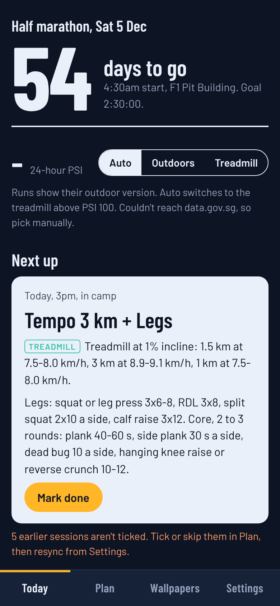
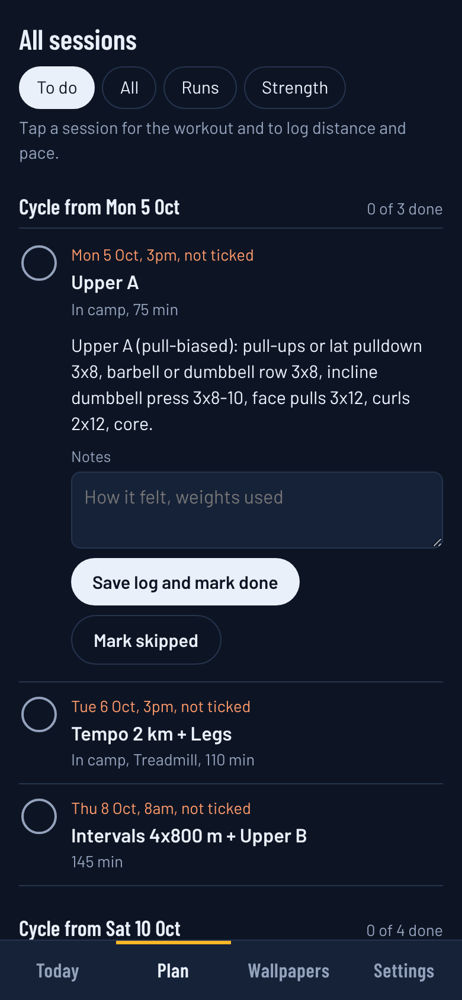
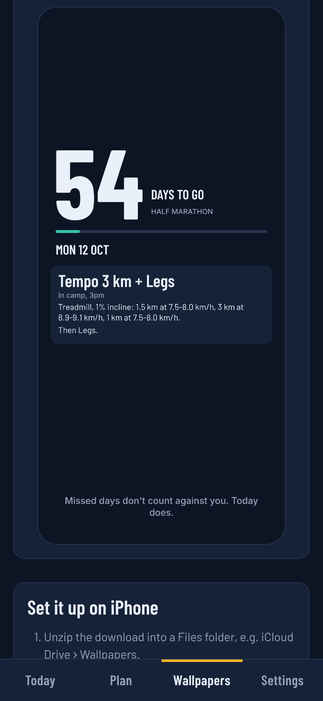
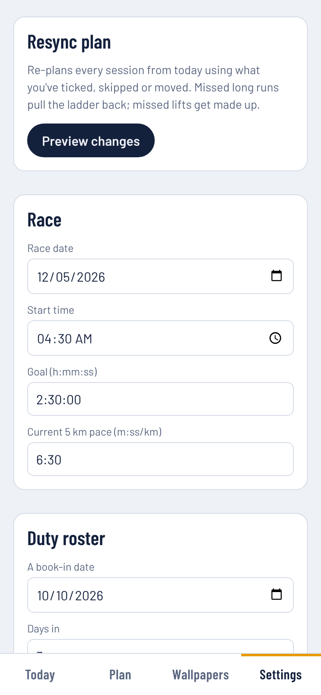

# Taper

**Race training planned around a rotating duty roster.** Taper builds a half-marathon plan around
shifts like Singapore NS's 3-days-in / 3-days-out, re-plans itself when sessions are missed, swaps
runs to the treadmill when the haze is bad, and exports a lock-screen wallpaper for every day to
race day.

<p>
  
  
  
  
</p>

## Why

Off-the-shelf plans assume Monday-to-Sunday weeks, the same gym every day and clean air. On a
rotating roster, some days have a full gym and treadmill, some only dumbbells, some have roads and a
public gym, and book-in/book-out evenings are gone. Miss a few sessions and a fixed plan just turns
red. Taper models the roster and re-derives the plan from what you've actually done.

## Features

- **Roster-aware generator.** Long runs on the last out-of-camp morning of each block; quality runs
  with heavy legs on camp weekdays (treadmill), never the day after a long run; dumbbell variants and
  a dumbbell leg day on weekend camp days; step-back week, peak ~2 weeks out, taper and race week.
- **Resync from today.** Reads the log, keeps history, moves sessions done on a different day,
  restarts a stale long-run ladder, continues tempo/interval progressions, and shows a diff before
  applying.
- **Haze mode.** Live 24-hour PSI from data.gov.sg (by region or highest region), NEA bands, and an
  Auto / Outdoors / Treadmill switch. Every run carries a treadmill version with speeds at 1% incline.
- **Tracker.** Countdown, next session, tick / log distance and pace / skip, kilometres run and a
  long-run ladder.
- **Daily wallpapers.** Canvas-rendered lock-screen images sized for current iPhones, exported as a
  ZIP of `YYYY-MM-DD.png` for a Shortcuts automation.
- **Calendar export.** RFC 5545 `.ics` with the haze alternative in each event.
- **PWA.** Installable from Safari, works offline, data stays on the device with JSON backup/restore.

## How it works

```
src/
  domain/        pure TypeScript, no React — unit-tested with Vitest
    duty.ts        maps any date onto the roster (camp weekday / camp weekend / out / leave)
    paces.ts       pace zones from goal time, km/h conversion for treadmills
    workouts.ts    run and lift builders (outdoor + treadmill text)
    generator.ts   block-by-block placement rules and the long-run ladder
    resync.ts      history from the log → regenerate from today → diff
    airQuality.ts  data.gov.sg PSI client, bands, treadmill decision
    ics.ts         calendar export
  state/         reducer + context, localStorage persistence, backup validation
  wallpaper/     content builder (tested) and canvas renderer
  ui/            Today, Plan, Wallpapers, Settings
```

## Run it

```bash
npm install
npm run dev      # http://localhost:5173
npm test         # domain, state and wallpaper tests
npm run build    # static build in dist/
```

Pushing to `main` runs the tests and deploys `dist/` to GitHub Pages (enable Pages → "GitHub Actions"
in the repo settings). On iPhone, open the site in Safari → Share → Add to Home Screen.

## Roadmap

See [ROADMAP.md](ROADMAP.md). Next up: Google Calendar two-way sync with clash detection against a
duty calendar, push reminders and PSI alerts, and a Capacitor iOS build with Apple Health import.
